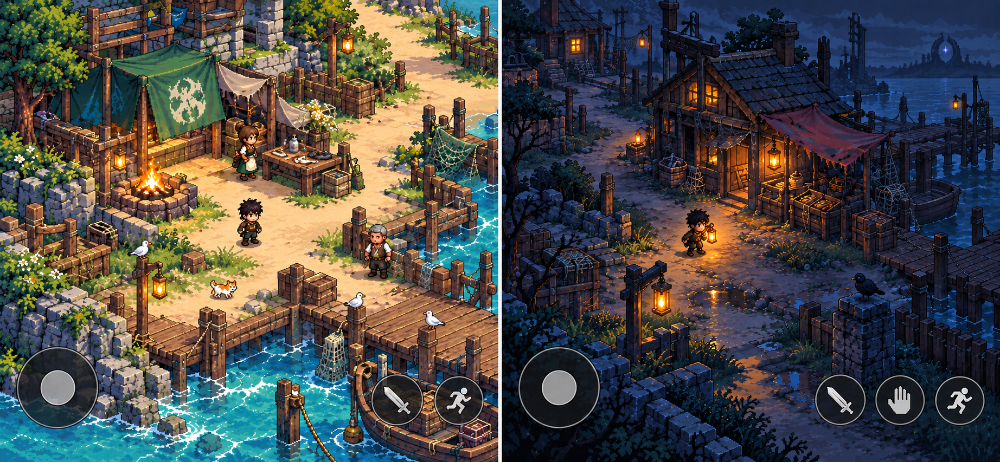

# Draft visual test — 3/4 camera prototype

**Status:** DRAFT — visual direction was selected by the user; concept prototype v1 generated and awaiting review

**Module lead:** Rendering & Art

**Coordinates with:** World & Terrain, UI & Input, Home & Building, Integration & QA

**Runtime status:** Not implemented. This brief is for a small visual test only; it does not authorize renderer migration or production-art promotion.

## Concept prototype v1

This generated board is a composition and mood study. It is not a runtime screenshot, approved final art, or a production asset.

| Review gate | Result | Evidence |
|---|---|---|
| HOME/OUTSIDE mood contrast | PASS for concept direction | HOME reads warm and inhabited; the MIRE MART scene reads colder and uncertain, with a small distant anomaly. |
| 3/4 camera composition | PASS for concept direction | The same diagonal view is used in both scenes, and paths, characters, props and depth are visible. |
| Pixel-art production readiness | REVISE | The image is pixel-styled, but some dense surface texture remains painterly. Do not promote it as final pixel art. |
| Phone-scale UI and readability | UNKNOWN | Controls are illustrative; the board has not been tested at the game's actual mobile viewport or against the live HUD. |
| Runtime overlap, movement and walkable-ground test | UNKNOWN | A still image cannot verify draw sorting, collision, or how the camera behaves while moving. |

## Goal

Check whether the concept image's 3/4 oblique top-down view can make the first ABYSSAL WAKE play space readable at game scale before planning a larger terrain or animation-art batch.

## Prototype scenes

1. **HOME, daytime:** a compact coastal Safe Camp with a clear entrance and walking route, a few readable shelter/work props, one or two residents, and warm practical lights. It should feel like a place people use, not a decorative showcase.
2. **OUTSIDE, dusk or night:** the nearby MIRE MART approach with a readable road or path, storefront silhouette, a lantern-lit player, one subtle failing light, and restrained early-anomaly color. Keep the first threat quiet and the path home understandable.

Use the same player scale and camera angle in both scenes. Mobile controls may be shown as a simple overlay concept so the board can test screen space; they are not a proposed UI redesign. Reuse only suitable reference or temporary blockout art, clearly labeled as non-production.

## Review gates

- At phone-sized display, the player, nearby NPC, path, and important props remain easy to distinguish.
- The player can be visually placed behind and in front of a prop without confusing overlap; the walkable ground remains visible.
- The HOME scene reads as warm and safe, while OUTSIDE feels cooler and uncertain without starting at full cosmic corruption.
- Attack, interact, and movement controls leave the immediate play area understandable.
- Pixels remain deliberately clustered and crisp at intended display size; painterly imagery is not treated as final runtime art.

Record each gate as **PASS**, **REVISE**, or **UNKNOWN**, with a short reason. The concept board passes mood and composition review only; it does not pass the pixel-art production or runtime camera gates. After the user reviews this board, refine it if needed, then prepare a separate, narrowly scoped renderer prototype proposal that tests projection and draw ordering with a representative player and prop. Estimate migration only after that test. Keep save, Relay/network authority, collision rules, and production manifest out of this visual gate.

## User decision after review

Choose one: **keep the visual direction**, **revise the prototype**, or **discard it**. A passing visual board still does not mean that the camera has been implemented in the game.
